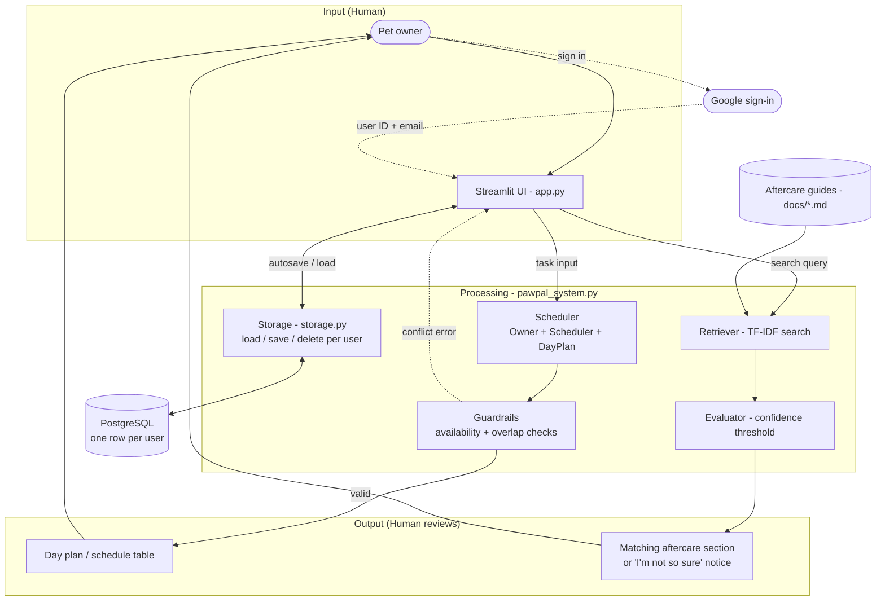

<p align="center"></p>

# PawsCare+

PawsCare+ is a Streamlit app that helps busy pet owners stay consistent with daily pet care. You add your pets and their care tasks (walks, feeding, medication, grooming), tell it when you're available, and it builds a schedule for the day. It blocks tasks that fall outside your available hours or overlap with each other, so you catch problems before they happen.

It also includes aftercare guides (spay/neuter, dental, wound, and vaccination) that you can **ask questions in plain words**. Claude answers using only those guides, shows which sections the answer came from, and says so when the guides don't cover something instead of guessing.

## Features

- **Pets and daily tasks.** Add multiple pets, then give each a daily routine: tasks with a time, duration, and priority, like "Breakfast at 8:00 AM." Check tasks off (checkmarks reset each day), undo, or delete them.
- **Guardrails.** A task is rejected if it starts before or ends after your available hours, or overlaps another task, with a message explaining what's wrong.
- **Schedule for any day.** Pick a date (it starts on your next available day) to see one time-ordered plan across all your pets, filterable by pet or status, with total and remaining minutes.
- **Ask PawsCare+ (AI).** Ask an aftercare question like "my dog threw up after her spay, is that normal?" Claude answers in plain language from the guides only, cites the sections it used, and flags anything the guides say needs a vet. Each user gets a daily question limit.
- **Keyword search.** A TF-IDF search over the guides in `docs/`, with a confidence check that answers "I'm not so sure" rather than returning a weak match.
- **Accounts and automatic saving.** Sign in with Google and your pets and tasks are saved to a PostgreSQL database, so they're there next time on any device. Each account only sees its own data.
- **Your data, your control.** Under **Manage my data**: download a copy as JSON, restore it later (with a confirmation before anything is replaced), start over, or delete everything saved for your account.

## Running it

Requires Python 3.10 or newer.

```bash
python -m venv .venv
source .venv/bin/activate        # Windows: .venv\Scripts\activate
pip install -r requirements.txt

streamlit run app.py             # the web app
python main.py                   # a command-line demo with sample pets
```

### Local mode vs. sign-in mode

With no settings, the app runs in **local mode**: there's no sign-in, and your data is saved in a file called `pawpal_local.db` on your computer. That's all you need to try it out.

To turn on Google sign-in and a hosted database, copy `.streamlit/secrets.toml.example` to `.streamlit/secrets.toml` and fill in:

- `[database]`: a PostgreSQL connection string (this project uses a free [Neon](https://neon.com) database).
- `[auth]`: a Google OAuth client ID and secret from Google Cloud Console, plus a random `cookie_secret`.
- `[anthropic]`: a Claude API key from the [Claude Console](https://console.anthropic.com), for the "Ask PawsCare+" helper. Without it, the AI tab is hidden and keyword search still works.

`secrets.toml` holds passwords, so it's listed in `.gitignore` and never pushed to GitHub. When deploying to Streamlit Community Cloud, paste the same contents into the app's **Secrets** setting instead.

## Deploying

PawsCare+ runs on [Streamlit Community Cloud](https://streamlit.io/cloud), with a free [Neon](https://neon.com) PostgreSQL database and Google sign-in.

1. Deploy the repo from share.streamlit.io with `app.py` as the main file.
2. In the app's **Settings → Secrets**, paste the same contents as your local `secrets.toml`, but set `redirect_uri` to `https://<your-app>.streamlit.app/oauth2callback`.
3. In Google Cloud Console, add that same URL to the OAuth client's **Authorized redirect URIs**, and publish the app (Audience → Publish app) so any Google account can sign in.

## Testing

```bash
pytest
```

The tests in `tests/test_pawpal.py` cover the scheduling rules (availability, overlaps, sorting, filtering, totals), pet and task management, saving and loading, and the aftercare search (ranking, deduplication, and the confidence check). They use a fixed date, so they give the same result on any day of the week.

`tests/test_storage.py` checks the database layer (saving, updating, keeping users separate, deleting) against a temporary SQLite file, and `tests/test_app.py` runs the whole app with Streamlit's test runner, including simulated Google sign-ins for two different users.

## How it's built



**Scheduling.** The app (`app.py`) collects pets, tasks, and availability and passes them to the `Owner` and `Scheduler` classes in `pawpal_system.py`. Before a task is added, guardrails check that it fits inside the owner's available hours and doesn't overlap another task. Generating a schedule produces a `DayPlan`, a time-sorted snapshot of the day's tasks.

**Aftercare guides.** There are two ways in. *Keyword search*: a TF-IDF retriever searches the markdown files in `docs/`, and an evaluator checks whether the best match is strong enough; if it isn't, the app says "I'm not so sure" instead of guessing. *Ask PawsCare+*: `ai.py` uses retrieval-augmented generation (RAG). It ranks guide sections with the same TF-IDF index, sends the most relevant ones (today, all of them fit) to Claude with the question, and asks for a structured reply: the answer, whether the guides cover it, which numbered sections it used, and whether to call the vet. The app shows the answer next to those exact sections so the user can check it.

**Accounts and saving.** Users sign in with Google through Streamlit's built-in `st.login()`. Google gives each account a permanent ID, and `storage.py` uses it as the key for that user's row in a `pawpal_owners` table. The row's `data` column holds their owner, pets, and tasks as JSON (made by `owner_to_dict`). After every click, the app compares the current data to what it last saved and writes to the database only if something changed.

## How the aftercare guides were checked

The four guides in `docs/` were first drafted with AI. Because the app's AI helper presents them to pet owners as the source of truth, each guide was then compared line by line against public veterinary sources (the AVMA, VCA Animal Hospitals, the FDA, a veterinary dental specialty practice, and two animal shelters' post-surgery instructions). Each guide now ends with a **Sources** section, and the app shows those sources with every answer.

What the review changed:

- **Corrected advice that contradicted the sources.** For example, the dental guide said pawing at the mouth was normal and to wait 48 hours before calling about a pet that won't eat. The dental specialist's guidance says to watch pawing closely and to call after 24 hours.
- **Added missing guidance.** For example: when an injection-site lump needs a vet (lasting over 3 weeks, growing, or painful), sneezing after nasal vaccines, which cleaning products to avoid on wounds, checking toes below a bandage, and which signs mean an emergency clinic rather than a phone call.
- **Removed a threshold no source supported.** The spay/neuter guide said to call if a pet hadn't urinated in 24 hours. The sources say bathroom habits can be off for a few days, so the guide now says that instead.

The guides are general information, not a vet's review of your pet. The app says so, and tells users to follow their own vet's instructions first.

## Design decisions

**I kept the logic separate from the UI.** Most of the real work lives in `pawpal_system.py` (scheduling, conflict checks, doc search, saving). `app.py` is mostly Streamlit forms and tables. That way I can test the important behavior with pytest without clicking through the app.

**I block bad schedules instead of fixing them automatically.** If a task is outside the owner's availability or overlaps another task, `add_todo()` and `generate_day_plan()` raise an error right away. I didn't want the app to silently move tasks around. I'd rather tell the user what's wrong and let them fix it.

- *Trade-off:* The app won't suggest a better time slot, so the user has to find a valid time on their own.

**Tasks are a daily routine, not one-off events.** Pet care repeats: breakfast at 8 AM happens every day. So adding a task only checks that it fits your hours and doesn't overlap another task. The day of the week only matters when you pick a date to schedule. Each task remembers the date it was last checked off, so checkmarks reset on their own each day.

- *Trade-off:* One-off tasks (a vet visit next Thursday) and limited-time tasks (meds for 7 days) aren't supported yet.
- *Why it changed:* The first version scheduled every task for "today" and checked today's day of the week, so someone available only on weekdays couldn't add any task on a weekend. A regression test now covers that case.

**"Today" means today where the user is.** Hosted servers run on UTC, which is already tomorrow in New York by 8 PM. The app uses the browser's timezone to decide what "today" is, so checkmarks reset at the user's midnight.

**I sort by time, not priority.** The user picks when each task happens, and the schedule shows tasks in chronological order. Priority is stored and shown in the table, but the scheduler doesn't reshuffle tasks based on it.

- *Trade-off:* Priority is more of a label than something that changes the plan. I think that makes sense for pet care: you usually know meds need to happen at 8 AM, and you mainly need help catching conflicts.

**A day plan is a snapshot.** `DayPlan` keeps its own copy of the task list, so sorting or filtering a plan never reorders the owner's master list.

**Keyword search first, then Claude on top of it (RAG).** The first version used only TF-IDF keyword search: it works offline, needs no API key, and is easy to test, but it only matches words, so "my dog threw up" wouldn't find the section about vomiting. Instead of replacing it, the AI helper reuses the same index to choose which sections to send, then lets Claude connect meaning to the text. Keyword search stays as a free fallback.

**Claude is kept on a short leash.** The system prompt says to answer only from the provided sections, never diagnose, never suggest medications that aren't in the guides, and to say when the guides don't cover a question. The reply is a structured tool call rather than free text, so the app knows whether the answer is covered and which sections it used. An answer that claims to be covered but cites no real section is shown as "not covered."

- *Trade-off:* Answers can only be as good as four short guides. That's intentional: an honest "the guides don't cover this, ask your vet" is better than a confident guess about a pet's health.

**A daily AI limit per user.** Each user gets 20 questions a day (configurable), counted in a `pawpal_ai_usage` table. Failed requests don't count. This keeps one person from using up the app's Claude credit. Claude Haiku 4.5 costs well under a cent per question here, so the limit is about protection, not price.

**One JSON row per user instead of separate tables.** Each user's pets and tasks are stored together as one JSON document rather than in separate `pets` and `tasks` tables. A user only ever loads and saves their own data as a whole, so this keeps the database code small and reuses the same format as the backup file.

- *Trade-off:* I can't easily run queries across users, like "how many cats are registered." If I needed that, I'd split it into proper tables.

**Stop rather than start empty when the database is down.** If loading fails, the app shows an error instead of an empty plan. Otherwise the next autosave would overwrite the user's real data with nothing.

**Overbooked days aren't trimmed.** `Scheduler.filter_tasks()` filters by pet or status, but it doesn't drop tasks when the total time is longer than your available window.

- *Trade-off:* The schedule might show more than you have time for. I'd rather show everything and let the owner decide what to skip than hide tasks.

## Limitations and next steps

- Every task repeats daily. There are no one-off or limited-time tasks yet (for example, "medication every 12 hours for 7 days").
- The aftercare guides cover four topics. You can't add your own vet's instructions yet (next up: paste a vet discharge sheet and get suggested tasks).
- Aftercare guides are general information and not a substitute for advice from a veterinarian.

## Project files

| File | What it does |
|------|--------------|
| `app.py` | Streamlit web app |
| `pawpal_system.py` | Scheduling, guardrails, aftercare search, JSON save/load |
| `storage.py` | Database: load, save, and delete each user's data; AI usage counts |
| `ai.py` | Ask PawsCare+: picks guide sections and asks Claude, grounded in them |
| `.streamlit/secrets.toml.example` | Template for sign-in and database settings |
| `main.py` | Command-line demo |
| `tests/` | Test suite (scheduling, storage, and full-app tests) |
| `docs/` | Aftercare guides used by the search |
| `diagrams/` | System and UML diagrams (Mermaid) |
| `reflection.md` | Project reflection |
| `ai_interactions.md` | Notes on working with AI tools |
