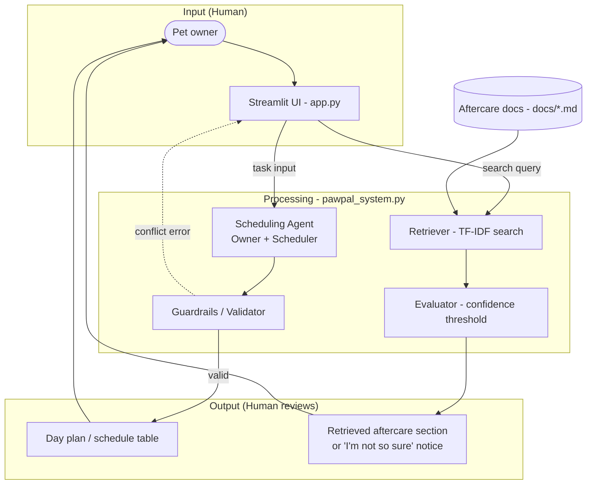

# PawPal+ (Module 2 Project)

You are building **PawPal+**, a Streamlit app that helps a pet owner plan care tasks for their pet.

## Context

A busy pet owner needs help staying consistent with pet care. They want an assistant that can:

- Track pet care tasks (walks, feeding, meds, enrichment, grooming, etc.)
- Consider constraints (time available, priority, owner preferences)
- Produce a daily plan and explain why it chose that plan

## What you will build (Original concept)

Your final app should:

- Let a user enter basic owner + pet info
- Let a user add/edit tasks (duration + priority at minimum)
- Generate a daily schedule/plan based on constraints and priorities
- Display the plan clearly (and ideally explain the reasoning)
- Include tests for the most important scheduling behaviors

## Getting started

### Setup

```bash
python -m venv .venv
source .venv/bin/activate  # Windows: .venv\Scripts\activate
pip install -r requirements.txt
```


## 🖥️ Sample Output


## 🧪 Testing PawPal+

```bash
# Run the full test suite:
pytest

# Run with coverage:
pytest --cov
```

Sample test output:


## 📐 Smarter Scheduling

> Fill in once you've implemented scheduling logic.

| Feature | Method(s) | Notes |
|---------|-----------|-------|
| Task sorting | DayPlan.sort_by_time() | Sorts tasks by scheduled time or priority; day plans are built in chronological order.|
| Filtering | Scheduler.filter_tasks() | Filters by status and pet; excludes tasks for unregistered pets. Does not yet drop tasks when time runs out |
| Conflict handling | task_schedule_conflicts() | Blocks tasks outside the owner’s availability window and overlapping time slots; raises AvailabilityError or ScheduleConflictError |

## Architecture Overview

My system diagram (`diagrams/system_diagram.mmd`) shows how PawPal+ is split into three main parts: what the user sees, what happens behind the scenes, and what comes back out.



**Scheduling.** The pet owner uses the Streamlit app (`app.py`) to add pets, tasks, and their availability. That info goes to my `Owner` and `Scheduler` classes in `pawpal_system.py`. Before anything gets added to the plan, guardrails check whether the task fits the owner's time window and whether it overlaps with another task. If everything looks good, the user gets a day plan sorted by time. If not, they see an error and can fix it.

**Aftercare docs.** There's also a separate search feature. The user types a question, and a TF-IDF retriever searches the markdown files in `docs/`. An evaluator checks if the match is good enough — if it's not, the app says "I'm not so sure" instead of guessing.

**Testing.** I wrote tests in `tests/test_pawpal.py` that hit the scheduling and search logic directly, so I can run `pytest` without opening the Streamlit app every time.

## Design Decisions

Here's why I built it the way I did, and what I had to give up along the way.

**I kept the logic separate from the UI.** Most of the real work lives in `pawpal_system.py` (scheduling, conflict checks, doc search). `app.py` is mostly Streamlit forms and tables. I did this so I could test the important stuff with pytest without needing to click through the app.

**I block bad schedules instead of fixing them automatically.** If a task is outside the owner's availability or overlaps another task, `add_todo()` and `generate_day_plan()` throw an error right away. I didn't want the app to silently move tasks around — I'd rather tell the user what's wrong and let them fix it.

- *Trade-off:* The app won't suggest a better time slot. That's simpler to build, but the user has to figure out a valid time on their own.

**I sort by time, not priority.** The user picks when each task happens, and the schedule displays tasks in chronological order. Priority is still stored and shown in the table, but the scheduler doesn't reshuffle tasks based on it.

- *Trade-off:* Priority is more of a label than something that actually changes the plan. I think that makes sense for pet care — you usually know meds need to happen at 8 AM, and you mainly need help catching conflicts.

**I used TF-IDF for doc search instead of an LLM.** The aftercare feature searches local markdown files with a simple TF-IDF index. If the query doesn't match well enough (`is_confident_query`), the app refuses to answer. I wanted something that works offline, doesn't need an API key, and is easy to test.

- *Trade-off:* It only catches keyword matches, so something like "my dog threw up" might not find a section about vomiting. For a small set of docs though, I think that's okay.

**Filtering doesn't trim tasks when you're overbooked.** `Scheduler.filter_tasks()` can filter by pet or status, but it doesn't drop tasks when the total duration is longer than the owner's available window.

- *Trade-off:* The schedule might show more tasks than you actually have time for. I figured it's better to show everything and let the owner decide what to skip, rather than hiding tasks.

