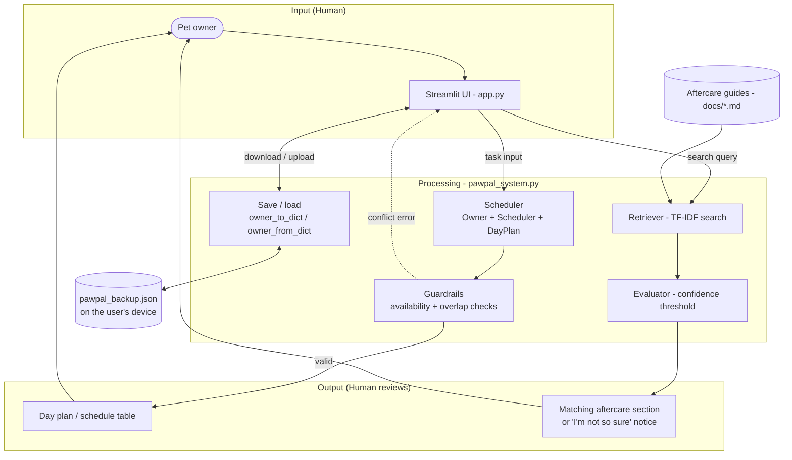

# 🐾 PawPal+

PawPal+ is a Streamlit app that helps busy pet owners stay consistent with daily pet care. You add your pets and their care tasks (walks, feeding, medication, grooming), tell it when you're available, and it builds a schedule for the day. It blocks tasks that fall outside your available hours or overlap with each other, so you catch problems before they happen.

It also includes a searchable set of aftercare guides (spay/neuter, dental, wound, and vaccination). If your question isn't covered by the guides, it says so instead of guessing.

## Features

- **Pets and tasks.** Add multiple pets, then schedule tasks for each with a time, duration, and priority. Mark tasks done or delete them.
- **Guardrails.** A task is rejected if it starts before or ends after your available hours, or overlaps another task, with a message explaining what's wrong.
- **Daily schedule.** One time-ordered plan across all your pets, filterable by pet or status, showing total and remaining minutes.
- **Aftercare search.** A TF-IDF search over the guides in `docs/`, with a confidence check that answers "I'm not so sure" rather than returning a weak match.
- **Save and restore.** Download your pets and tasks as a JSON backup and upload it later. Nothing is stored on a server.

## Running it

Requires Python 3.10 or newer.

```bash
python -m venv .venv
source .venv/bin/activate        # Windows: .venv\Scripts\activate
pip install -r requirements.txt

streamlit run app.py             # the web app
python main.py                   # a command-line demo with sample pets
```

## Testing

```bash
pytest
```

The tests in `tests/test_pawpal.py` cover the scheduling rules (availability, overlaps, sorting, filtering, totals), pet and task management, saving and loading, and the aftercare search (ranking, deduplication, and the confidence check). They use a fixed date, so they give the same result on any day of the week.

## How it's built



**Scheduling.** The app (`app.py`) collects pets, tasks, and availability and passes them to the `Owner` and `Scheduler` classes in `pawpal_system.py`. Before a task is added, guardrails check that it fits inside the owner's available hours and doesn't overlap another task. Generating a schedule produces a `DayPlan`, a time-sorted snapshot of the day's tasks.

**Aftercare guides.** The user types a question, and a TF-IDF retriever searches the markdown files in `docs/`. An evaluator checks whether the best match is strong enough. If it isn't, the app says "I'm not so sure" instead of guessing.

**Saving.** `owner_to_dict` and `owner_from_dict` turn the owner, pets, and tasks into JSON and back. The app offers this as a download/upload backup.

## Design decisions

**I kept the logic separate from the UI.** Most of the real work lives in `pawpal_system.py` (scheduling, conflict checks, doc search, saving). `app.py` is mostly Streamlit forms and tables. That way I can test the important behavior with pytest without clicking through the app.

**I block bad schedules instead of fixing them automatically.** If a task is outside the owner's availability or overlaps another task, `add_todo()` and `generate_day_plan()` raise an error right away. I didn't want the app to silently move tasks around. I'd rather tell the user what's wrong and let them fix it.

- *Trade-off:* The app won't suggest a better time slot, so the user has to find a valid time on their own.

**I sort by time, not priority.** The user picks when each task happens, and the schedule shows tasks in chronological order. Priority is stored and shown in the table, but the scheduler doesn't reshuffle tasks based on it.

- *Trade-off:* Priority is more of a label than something that changes the plan. I think that makes sense for pet care: you usually know meds need to happen at 8 AM, and you mainly need help catching conflicts.

**A day plan is a snapshot.** `DayPlan` keeps its own copy of the task list, so sorting or filtering a plan never reorders the owner's master list.

**I used TF-IDF for doc search instead of an LLM.** The aftercare search uses a simple TF-IDF index over local markdown files. If the query doesn't match well enough (`is_confident_query`), the app refuses to answer. I wanted something that works offline, doesn't need an API key, and is easy to test.

- *Trade-off:* It only catches keyword matches, so a question like "my dog threw up" might not find a section about vomiting.

**Backups instead of a database.** The app doesn't store anyone's data on a server. You download a JSON backup and upload it to pick up where you left off.

- *Trade-off:* If you close the tab without downloading a backup, your changes are gone.

**Overbooked days aren't trimmed.** `Scheduler.filter_tasks()` filters by pet or status, but it doesn't drop tasks when the total time is longer than your available window.

- *Trade-off:* The schedule might show more than you have time for. I'd rather show everything and let the owner decide what to skip than hide tasks.

## Limitations and next steps

- Tasks are scheduled for today only. There are no recurring tasks yet (for example, "medication every 12 hours for 7 days").
- The aftercare search only covers the four built-in guides. You can't add your own vet's instructions yet.
- Aftercare guides are general information and not a substitute for advice from a veterinarian.

## Project files

| File | What it does |
|------|--------------|
| `app.py` | Streamlit web app |
| `pawpal_system.py` | Scheduling, guardrails, aftercare search, save/load |
| `main.py` | Command-line demo |
| `tests/test_pawpal.py` | Test suite |
| `docs/` | Aftercare guides used by the search |
| `diagrams/` | System and UML diagrams (Mermaid) |
| `reflection.md` | Project reflection |
| `ai_interactions.md` | Notes on working with AI tools |
